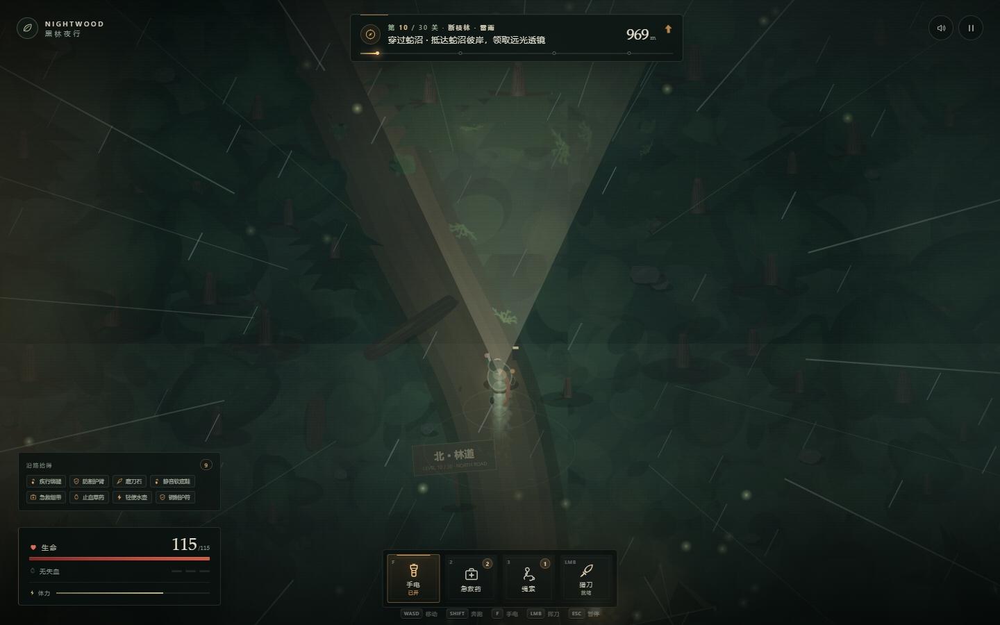

# 黑林夜行 · NIGHTWOOD

一款发生在深夜密林中的单人生存穿越小游戏。你带着一束手电、一把猎刀、一卷绳索和有限的急救药物，要连续穿过 **六片地貌、30 段远征**。每片区域都是一整段近千米长的林路，终点在真正的峡谷、沼泽、石林或山口之后；每抵达一处关隘，就会获得一件新的随身物品，带着它进入下一关，直到黎明。

整个森林、角色、动物、光效与声音都由代码实时生成，没有外部图片或音频素材，离线即可游玩。



## 立即游玩

直接双击打开 **`index.html`** 即可（也可打开单文件版 **`night-forest.html`**）。

如果浏览器对本地文件限制较多，也可以在目录中启动一个本地静态服务器：

```powershell
python -m http.server 8765
```

然后访问 `http://127.0.0.1:8765/`。

推荐使用桌面版 Chrome / Edge，耳机体验更佳；手机浏览器会显示虚拟摇杆和触摸按钮。

## 六片地貌 · 30 关与随身物品

- 共 **30 关**，分成六片地貌，每片 5 关：
  1. **黑森林**：北侧峡谷横断去路，第一关就要用绳索过峡。
  2. **蛇沼**：湿地拖慢脚步，蛇影更多，雾更绿。
  3. **石林**：树木变少、岩石成阵，路径被石脊切碎。
  4. **灰烬林**：空气发暖，余烬随风飘，野兽更躁。
  5. **长夜**：光照被压暗，最考验手电和听觉。
  6. **北坡**：冷杉、风声和最后的狼群，尽头是黎明林道。
- 每关的目标在 **约 950–1,200 米林路之外**（HUD 距离），不是几步路就能到的“小出口”；后半程关卡会一路穿过断崖、兽径和长夜。
- 每关使用新的程序化森林；区域会有不同的雾气、色调、树木/岩石密度与额外野兽。
- 每关尽头是真正的关隘界碑，穿过即过关，并从界碑领取 **1 件随身物品**，立即在下一关生效：
  - 强光电池、远光透镜、备用电池组：扩大手电照明。
  - 疾行绑腿、猎手靴、备用刀鞘、猎刀配重：提升移动、奔跑或挥刀速度。
  - 防割护臂、铁皮护胸、狼牙项链、野猪皮甲、黎明护符：降低受到的伤害。
  - 磨刀石、银制刀锋：提高猎刀伤害。
  - 静音软底鞋、兽骨哨、静音斗篷、夜行者披风：降低动物警觉或奔跑噪音。
  - 急救绷带、强心剂、急救药箱：提高生命上限或每关额外携带药物。
  - 止血草药、蛇药：降低失血速度。
  - 轻便水壶、蜂蜜干粮：提高体力上限或恢复速度。
  - 铜制护符、护心镜：每关抵挡一次伤害。
  - 第 30 关奖励“林道徽章”，作为穿越整片黑森林的纪念。
- 每一关都要跨过中央大峡谷；南侧锚点的绳索是必经机制。蛇沼的泥泞会减速，长夜会压暗视野。
- 左上角“沿路拾得”会记录已经获得的物品，左侧 HUD 只展示最近 8 件，物品总数会单独显示。

## 跑动效果

按住 `Shift`（或手机摇杆推到底）进入奔跑。角色现在会：

- 身体朝向移动方向，头部、手电和猎刀仍各自追踪瞄准方向；
- 用分段的大腿、小腿和靴子做交替步态，手臂反向摆动，背包和围巾随步伐晃动；
- 起步有短暂加速、停步有减速，急转弯时身体侧倾；
- 奔跑时步频与真实移动距离同步，左右脚交替落地并踢起尘土/落叶；
- 半透明绿色残影、镜头向前预判、轻微变焦和步伐震动；
- 屏幕速度线、暖冷双色冲刺压力、分层风声、沉重脚步、喘息和起跑破风声。

停下后这些效果会平滑衰减，不会一直糊在画面上。

## 动物声音

动物声音按种类、距离和方位分别合成，不再共用一个“低吼”：

- 夜狼：带气流和泛音的远嚎、近距离低吼/龇牙；
- 野猪：低频哼声、鼻息和冲锋前的沉重踏步；
- 黑蝰蛇：高频、带气声的嘶鸣；
- 靠近的野兽有左右声像；奔跑和攻击会改变音量、距离感与节奏；
- 狼、猪、蛇在不同状态（警觉、追击、蓄力、游荡）会发出不同声音。

## 每关天气

30 关各自拥有不同天气，天气会同时改变画面、声音和数值：

| 天气 | 效果 |
| --- | --- |
| 晴夜 / 冷月 / 静夜 | 视野最好，虫鸣与远嚎清晰 |
| 薄雾 / 浓雾 / 霜雾 / 冰雾 | 雾层压低能见度，手电射程缩短，动物更近才发现你 |
| 细雨 / 闷热雨 / 余烬雨 / 冻雨 | 雨线、湿润冷色、雨声；动物警觉略降但体力消耗增加 |
| 雷雨 / 石林雷雨 | 雨幕 + 闪电照亮 + 雷声；能见度最低 |
| 山风 / 石尘风 / 穿林风 / 北风 | 风线、树叶横飞、风声增强；奔跑更耗体力 |
| 灰烬风 / 烟霾 / 火星夜 | 橙色空气、飘落余烬、低沉热风声 |
| 雪粒 / 暴雪 / 黎明雪 | 飘雪、冷色空气、雪地减速与安静雪声 |

每关的天气名称会显示在关卡标题和 HUD 上，进入下一关时切换。

## 操作

| 操作 | 键位 | 说明 |
| --- | --- | --- |
| 移动 | `WASD` / 方向键 | 在森林中穿行 |
| 奔跑 | 按住 `Shift` | 消耗体力，但有完整的速度视觉/听觉反馈 |
| 瞄准 / 照射 | 移动鼠标 | 手电光锥与挥刀方向跟随鼠标 |
| 挥刀 | 鼠标左键 / `Space` | 消耗少量体力，可击退或杀死野兽 |
| 手电开关 | `F` | 关灯更难被发现，但几乎看不清前路 |
| 使用急救药 | `2` | 止血并恢复生命 |
| 使用绳索 | `3` | 仅在断崖南侧锚点有效 |
| 交互 | `E` | 固定绳索、割开补给箱藤蔓 |
| 暂停 | `Esc` / `P` | 暂停并查看本关进度 |
| 静音 | `M` 或右上角按钮 | 关闭 / 打开所有声音 |

**手机 / 平板**：左侧摇杆移动，推到底自动奔跑；右侧依次是手电、急救、交互（E）与猎刀。

## 生存规则

- **失血会持续扣血。** 被咬伤会叠加最多 3 层失血，层数越高掉血越快，屏幕边缘也会变红。按 `2` 可以一次性止血并恢复生命。
- **手电是双刃剑。** 它能照见动物、路径和断崖，但开灯与奔跑会显著扩大动物的警觉范围。关灯慢行可以绕过不少东西。
- **不要恋战。** 夜狼速度快、会扑咬；野猪会蓄力冲锋；黑蝰蛇藏在暗处，一口就会造成严重失血。刀能杀敌，但体力有限。
- **绳索只有一根。** 断崖横贯整片森林，必须到南侧锚点按 `E` 固定绳索才能继续北上。
- **补给藏在林子里。** 藤蔓覆盖的木箱、遗落的药盒都能补充急救药物；有些需要靠近后按 `E` 打开。
- **每关重新开始。** 死亡会重试当前关卡，已经获得的随身物品会保留；回到标题会重置整轮 30 关。

## 文件结构

```
night-forest/
├─ index.html          游戏页面
├─ style.css           界面与排版
├─ game.js             游戏逻辑、30 关流程、奖励与渲染
├─ night-forest.html   单文件离线版（可直接分享）
├─ preview.png         游戏预览图
└─ README.md
```

## 技术说明

- 纯 HTML5 Canvas 2D，零第三方运行时依赖。
- 每关按种子程序化生成森林；树木、蕨类、灌木、草丛使用预烘焙精灵缓存。
- 手电使用离屏遮罩与多层柔光，形成可转向的光锥；动物眼睛在黑暗中仍会反光。
- 音效全部由 Web Audio 振荡器与噪声实时合成，包括风声、虫鸣、脚步、挥刀、心跳、冲刺风声、天气层，以及按动物种类、距离和左右方位合成的狼嚎/猪哼/蛇嘶。
- 30 件奖励物品通过统一的属性修正表生效，HUD、关卡结算与下一关属性保持一致。
- 桌面键鼠与移动端触控两套输入；失焦自动暂停，支持窗口缩放与高 DPI。

## 已验证

- 六片地貌的长关卡流程、关卡目标切换、最终关“黎明”结算
- 每关奖励物品发放、物品叠加、生命上限/护盾/伤害修正
- 分段四肢跑动、身体朝向移动方向、左右脚落点尘土、减速/加速
- 奔跑残影、落叶/尘土粒子、屏幕速度线、镜头预判
- 30 关不同天气：雨、雪、雾、雷雨、灰烬、风与各自的声音层
- 按种类/方位/距离合成的狼嚎、猪哼、蛇嘶和野兽脚步
- 大峡谷绳索、蛇沼减速、章节色调与额外野兽
- 关卡界碑、HUD 物品栏、奖励弹窗
- 桌面 1440×900 与移动端横屏布局
- Chrome 无头浏览器自动化流程无 JavaScript 异常
